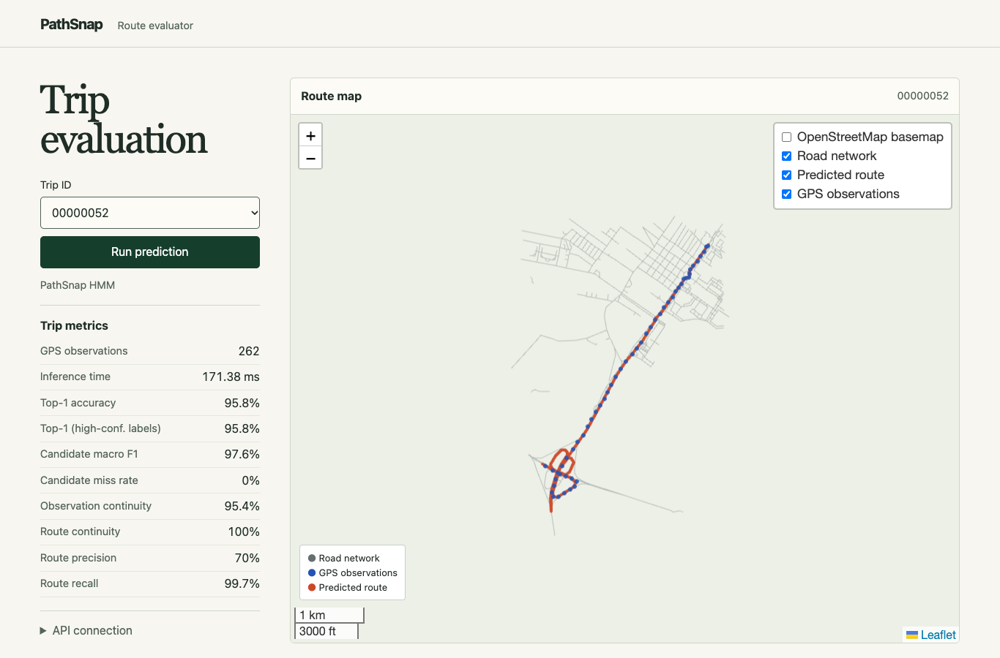

# PathSnap report handoff

## 6. Geographical visualisation using Folium

Figure 6.1 shows student-test trip `00000052` with the final tuned LightGBM classifier and HMM (`v2-classifier-hmm`). Blue points show every fifth valid GPS observation and the final valid observation. Gray lines show directed road geometry within the trajectory's projected bounding box, padded by 200 metres. Orange is the predicted route and green is the ordered reference route. The HTML map lets readers toggle layers and zoom to inspect disagreements. Disconnected arc transitions are drawn in separate line sections.

On this trip, the final predictor agreed with 251 of 262 aligned reference labels (95.8% Top-1). Each adjacent pair of arcs in the reconstructed route was connected.

Reproduce the interactive map with `python -m visualisation.maps 00000052 results/student_test_00000052.html --reference`.

## 7. API, UI and deployment

Laptop 2 loads the evaluator UI and requests the available trip IDs from `GET /trips` on laptop 1. On selection, `POST /predict` sends the trip ID. Laptop 1 loads the track and road graph, runs the active predictor and then scores its result against the reference using the team’s shared v1 aligner. The UI displays GPS observations, road geometry, the predicted route and aggregate metrics. Reference labels and geometry stay on laptop 1. The map's vector layers work on a LAN without internet.

All ten student-test trips returned HTTP 200 with a map and metrics in the final API test. Figure 7.1 shows the evaluator on the development laptop. [Final student-test API metrics](deployment/student_test_classifier_hmm.csv) and [API receiving logs](deployment/student_test_classifier_hmm_api.log) are from the running API. Inference time in the table measures the predictor call and output validation. API elapsed time in the log also includes file loading, scoring and map rendering.

The API matched local direct inference on all ten student-test trips, including confidence scores. Against the fixtures in commit `6a1b535`, all ten trips matched point-level arcs, ordered candidate IDs, and diagnostics. Nine reconstructed routes matched every arc ID. Trip `00000009` differed at three connector IDs, each with the same directed endpoint pair as its fixture counterpart. The routes therefore used the same ordered node pairs. Confidence differed by at most `2.22e-16`.

On student-test, the team’s [final comparison](final_comparison.csv) reports mean per-trip Top-1 agreement of 88.39% for the classifier alone and 88.24% after HMM decoding. The HMM reduced the mean number of disconnected joins per trip from 14.6 to 0.6 and increased mean route precision from 64.84% to 82.44%.

Reproduce the final student-test API check with `python -m scripts.check_api --direct-data data/student_test --csv results/deployment/student_test_classifier_hmm.csv`. All ten reserved trips also completed a local browser rehearsal. During the official two-laptop run, capture the evaluator UI and the API terminal for the same successful request. The student-test figures above provide the local deployment evidence.
