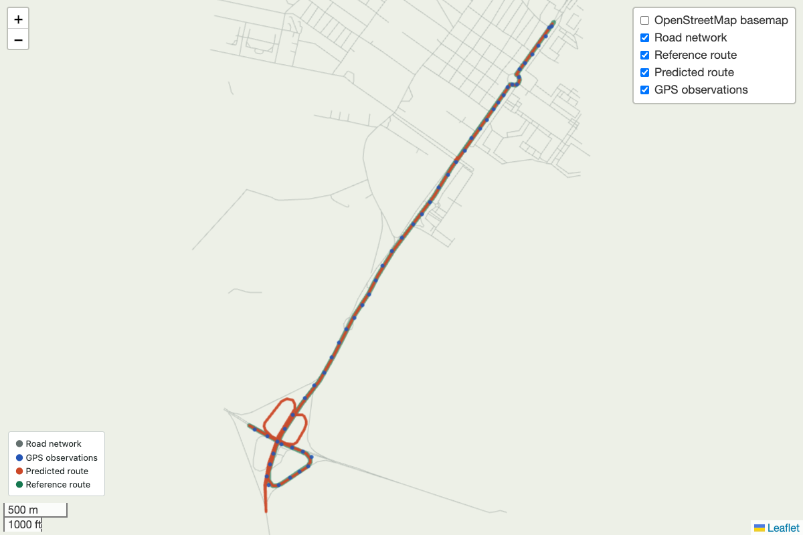

# PathSnap report handoff

## 6. Geographical visualisation using Folium

Figure 6.1 shows student-test trip `00000052` with the tuned, distance-only HMM. Blue points show every fifth valid GPS observation and the final valid observation. Gray lines show directed road geometry within the trajectory's projected bounding box, padded by 200 metres. Orange is the predicted route and green is the ordered reference route. The HTML map lets readers toggle layers and zoom to inspect disagreements. Disconnected arc transitions are drawn in separate line sections.

On this trip, the tuned HMM agreed with 252 of 262 aligned reference labels (96.2% Top-1). Each adjacent pair of arcs in the reconstructed route was connected. Regenerate this figure after integrating the classifier and selecting the combined emission settings.

Reproduce the interactive map with `python -m visualisation.maps 00000052 results/student_test_00000052.html --reference`.

## 7. API, UI and deployment

Laptop 2 loads the evaluator UI and requests the available trip IDs from `GET /trips` on laptop 1. On selection, `POST /predict` sends the trip ID. Laptop 1 loads the track and road graph, runs the active predictor and then scores its result against the reference using the team’s shared v1 aligner. The UI displays GPS observations, road geometry, the predicted route and aggregate metrics. Reference labels and geometry stay on laptop 1. The map's vector layers work on a LAN without internet.

All 10 supplied student-test trips returned HTTP 200 and displayed a prediction map and metrics in Chrome on the development laptop using its LAN API address. [Per-trip tuned HMM metrics](deployment/student_test_hmm_aligned.csv) and [API receiving logs](deployment/student_test_api.log) are from the running API. Inference time in the table measures the predictor call and output validation. API elapsed time in the log also includes file loading, scoring and map rendering.

The regenerated reference CSVs for trips `00000052` and `00000056` matched 4,220 label rows from A’s integer-millimetre aligner. The API returned the same arcs, ordered candidates, routes and diagnostics as a direct run of C’s predictor on this Mac for all 10 trips. Across C’s regenerated fixtures at `9e8143b`, candidates in order, diagnostics and confidence matched all 10 trips. Three trips matched every field exactly. There were 46 differing per-observation arc IDs and one differing reconstructed route (trip `00000009`). Trip `00000007` matched exactly. Trip `00000065` differed on two observation arcs and retained two segments. Trip `00000056` differed on four observation arcs and recorded 10 disconnected joins in both runs. The API outputs matched a direct run on this laptop across all 10 trips.

C’s [decoder experiment](decoder_student_test.csv) reports mean per-trip Top-1 agreement of 86.58% with the previous tuned parameters under the shared preprocessing pipeline and 86.70% with the retuned parameters. Mean route precision was 80.10% and 77.74%, respectively.

For the final evidence, configure the team predictor and run `python -m scripts.check_api --direct-data data/student_test --csv results/deployment/student_test_final.csv` against all 10 student-test trips. Regenerate Figure 6.1 with that predictor. On the two demo laptops, capture the evaluator UI and the API terminal for the same successful trip request. The evaluator partition is supplied separately.
